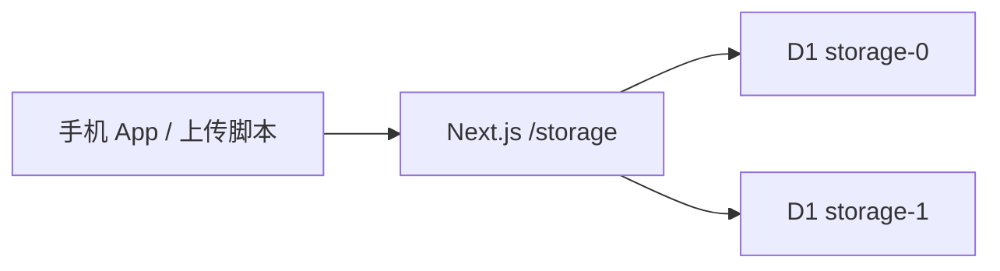
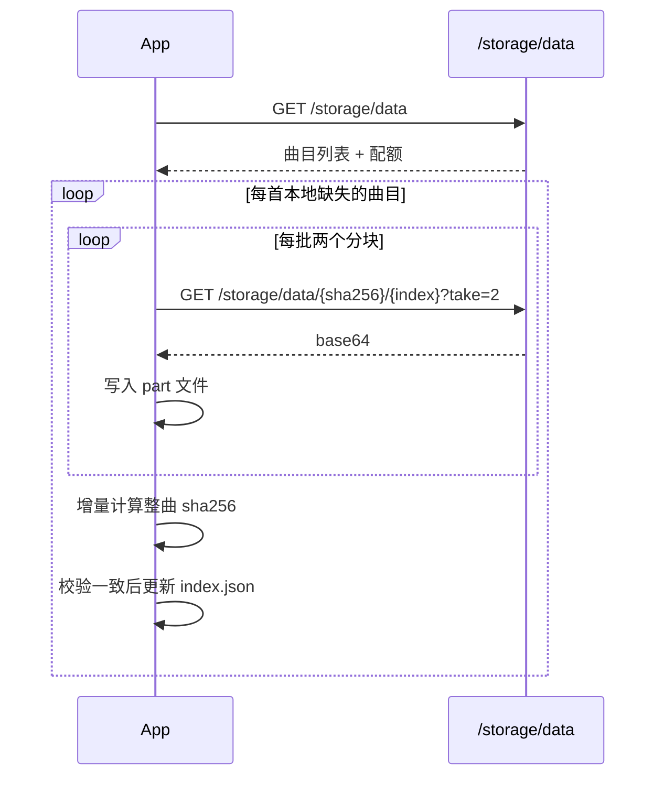

# /storage 设计

## 容量与分片

D1 免费计划单库上限 500 MB，每账号总存储 5 GB。预留的 1 GB 用两个数据库承载：`songs-storage-0/1`，每个应用层上限 `SHARD_MAX_BYTES = 470,000,000` 字节，全局配额 `STORAGE_QUOTA_BYTES = 940,000,000` 字节，余下的 60 MB 留给 SQLite 的页与索引开销。

音频按 base64 存放，940 MB 配额约合 705 MB 音频。新歌写入占用较少的库，两个库都写满返回 507。按 `sha256` 读取时并发查询两个库。



## 表结构

两个库使用同一份 schema。

`storage_song`：`sha256`（主键）、`name`、`singers`（JSON 数组文本）、`format`、`mime`、`byte_size`、`chunk_size`、`chunk_count`、`payload_bytes`（配额记账）、`status`（`uploading`/`ready`）、`created_at`。

`storage_chunk`：`sha256`、`idx`、`chunk_sha256`、`data`（base64），主键 `(sha256, idx)`。

`storage_usage`：单行表，`used_bytes`。

## 接口

上传需要请求头 `x-storage-password`（沿用 `SONGLIST_PASSWORD`），下载公开。

| 方法 | 路径 | 说明 |
|---|---|---|
| POST | `/storage/upload` | 初始化上传；带 `data` 时一次性写入 |
| PUT | `/storage/upload/{sha256}/{index}` | 上传单个分块，幂等 |
| POST | `/storage/upload/{sha256}/complete` | 校验齐全后置为 `ready` |
| DELETE | `/storage/upload/{sha256}` | 取消 `uploading` 状态的曲目 |
| GET | `/storage/data` | 曲目列表与配额 |
| GET | `/storage/data/{sha256}` | 整曲 base64，超过 2,800,000 字节返回 413 |
| GET | `/storage/data/{sha256}/{index}` | 分块，`take` 最多 2，超过返回 413 |

初始化请求体：

```json
{
  "name": "夜曲",
  "singers": "周杰伦，费玉清",
  "fileName": "yequ.mp3",
  "byteSize": 5242880,
  "sha256": "9f2c…",
  "data": "//uQx…"
}
```

`singers` 按 `[,，]` 切分、去空白、丢弃空项，至少一项。`fileName` 扩展名决定格式与上限：`.mp3` 上限 100 MiB，其他音频上限 20 MiB。`.mp3` 的第 0 个分块要匹配 ID3 头或帧同步，否则 415。`sha256` 已存在时返回 `duplicated: true`，不写数据。

分块响应带 `X-Song-Sha256`、`X-Chunk-Index`、`X-Chunk-Count`、`X-Total-Size`、`Cache-Control: public, max-age=31536000, immutable`；列表接口用 `no-store`。

错误码：400 `INVALID_REQUEST`/`CHUNK_HASH_MISMATCH`、401 `UNAUTHORIZED`、404 `SONG_NOT_FOUND`/`CHUNK_NOT_FOUND`、409 `INCOMPLETE_UPLOAD`/`UPLOAD_NOT_PENDING`、413 `FILE_TOO_LARGE`/`SONG_TOO_LARGE`/`TOO_MANY_CHUNKS`、415 `UNSUPPORTED_FORMAT`、507 `STORAGE_FULL`。

## 常量

| 名称 | 值 | 依据 |
|---|---|---|
| `CHUNK_SIZE` | 1,400,000 | base64 后 1,866,668 字节，低于 D1 单行 2,000,000 字节上限 |
| `MAX_INLINE_BYTES` | 2,800,000 | base64 后 3,733,336 字节，低于 Vercel 4.5 MB 响应上限 |
| `MAX_TAKE` | 2 | 两块 base64 约 3.73 MB |
| `MAX_MP3_BYTES` | 104,857,600 | 100 MiB |
| `MAX_OTHER_AUDIO_BYTES` | 20,971,520 | 20 MiB |
| `SHARD_MAX_BYTES` | 470,000,000 | 单库 500 MB 的余量 |
| `STORAGE_QUOTA_BYTES` | 940,000,000 | 两个库可用字节之和 |

100 MiB 的 mp3 分成 75 块，上传方发 75 次 `PUT`。

## 代码位置

```
lib/d1.ts
lib/storage/constants.ts
lib/storage/shards.ts
lib/storage/songs.ts
app/storage/upload/route.ts
app/storage/upload/[sha256]/route.ts
app/storage/upload/[sha256]/[index]/route.ts
app/storage/upload/[sha256]/complete/route.ts
app/storage/data/route.ts
app/storage/data/[sha256]/route.ts
app/storage/data/[sha256]/[index]/route.ts
scripts/init-storage-d1.mjs
scripts/upload-storage-song.mjs
```

环境变量：`CLOUDFLARE_ACCOUNT_ID`、`CLOUDFLARE_D1_TOKEN`（D1 Read + D1 Write）、`STORAGE_D1_DATABASES`（两个 uuid）。`vercel.json` 增加 `"regions": ["hkg1"]`。`/storage` 与 `/api/songs` 的 `songlist` 是两套独立数据。

## 手机应用

项目位置 `/Users/daisy/develop/songs-app`，`nsh init songs-app --template ts`。

`nsh.json` 的能力声明只允许 `GET` 前缀 `/storage/data`，写操作在能力层被拒：

```json
{
  "capabilities": {
    "network": {
      "hosts": ["songs.petals.top"],
      "http": [
        { "host": "songs.petals.top", "methods": ["GET"], "pathPrefix": "/storage/data" }
      ]
    },
    "fs": { "read": ["${dataDir}"], "write": ["${dataDir}"] }
  },
  "appearance": "system",
  "theme": "theme.json"
}
```

`theme.json` 取自 cockpit 的 Morganite（浅色）与 Nocturne（深色）：`background` `#fdf7f8`/`#1c1e20`、`foreground` `#3b282c`/`#e3e6e8`、`card` `#f8edef`/`#232629`、`muted-foreground` `#93737b`/`#9aa1a8`、`primary` `#9c5a6b`/`#8b98a3`、`primary-foreground` `#fdf7f8`/`#1c1e20`、`border` `#3b282c14`/`#e3e6e814`、`ring` `#9c5a6b66`/`#8b98a366`、`destructive` `#fb2c36`/`#e0645f`、`success` `#3d8b5a`/`#6fbf8b`、`selection` `#e3aeb8`/`#4a5056`、`radius` 10px。

底部用 `nsh/mobile` 的 `TabBar`，两个标签：`云端`、`本地`，每个标签一份 `createNavStack`。

- 云端：`List` 每行显示歌名、歌手（`、` 连接）、状态（已下载 / 大小 / 百分比），标题栏右侧 `全部拉取`（下载中变 `停止`），顶部显示配额，下拉刷新。
- 本地：同样的行，行尾删除按钮，标题栏右侧 `全部清空`。

### 界面与进度

- 首帧：列表请求返回之前渲染 6 行骨架，行高与真实行一致（60），骨架期间不显示空状态文案。空状态只在请求成功且结果为空时出现，按原因分成 `服务器还没有歌曲` 与 `全部已下载` 两种。
- 进度：列表响应里带每首歌的 `byteSize`，按下「全部拉取」的瞬间就能算出要下载的总字节数。总进度用 `已完成字节 / 需下载总字节`，单曲进度用 `已接收字节 / byteSize`，两项都是确定值。界面上不出现 `正在准备`、`请稍候` 这类没有数值的提示。
- 主线程：每写完一个分块 `await` 一次，让出 JS 线程。整曲 sha256 按分块增量计算，单次同步哈希只处理 1.4 MB；进度 signal 每块更新一次，不按字节更新。网络与文件操作全部写在 async 函数里，渲染函数里不做同步 I/O。
- 按钮状态：拉取进行中标题栏按钮变成 `停止`，行内单独下载全部禁用；停止、失败或全部完成后恢复。删除进行中该行显示 spinner 并禁用这一行的按压。
- 错误：就地显示在该行下方，附 `重试`，文案取服务端返回的 `error` 原文。只有删除确认使用 `AlertDialog`，其他错误不做模态打断。
- 超时：每个请求带 `AbortSignal.timeout(30_000)`，超时按失败处理，重试从该曲第 0 块重新开始。
- 滚动：`List` 保持虚拟化，每一行只读自己那条记录的 signal，不读全局进度，避免一行变化引起整屏重绘。
- 安全区：`NavPage` 内的列表用 `contentInset` 留出底部 tab 栏与状态栏的高度，最后一行不被遮挡。
- 深色：颜色全部走 theme token，不写死十六进制色值。

本地目录：

```
${dataDir}/library/index.json
${dataDir}/library/audio/<sha256>/000.part
```

`index.json` 记录 `sha256`、`name`、`singers`、`format`、`byteSize`、`chunkSize`、`chunkCount`、`downloadedAt`。写索引用 `writeFile` 写 `index.json.tmp` 再 `rename`。



跳过规则：`index.json` 有该 `sha256`，且 part 文件数量等于 `chunkCount`、除最后一块外每块大小等于 `chunkSize`。

并发：一次一首歌，一首歌内一次一个请求；用 `AbortController` 响应 `停止`、页面切走与网络错误。

失败处理：HTTP 非 2xx、base64 解码失败、分块数量或字节数不符、整曲 sha256 不符，立刻终止本轮，显示服务端 `error` 原文，删除当前歌曲的分块，已完成歌曲的索引保留。

删除歌曲：逐个 `unlink` part，`rmdir` 目录，从 `index.json` 移除条目。

运行：

```sh
nsh run App.tsx --target android
```

前置条件当前都缺：`nsh` CLI、Android SDK（`platforms;android-35`、`build-tools`、`platform-tools`）、`adb` 能列出 vivo X200S。

## 验收

服务端：4 MB mp3 单次上传后下载校验 sha256；100 MiB mp3 分块上传并测试续传；25 MB flac 返回 413；`.txt` 返回 415；重复 sha256 返回 `duplicated` 且 `usedBytes` 不变；5 MB 歌曲请求整曲接口返回 413；`take=3` 返回 413；配额用尽返回 507。

手机端：首次拉取条数与服务端一致；再次拉取只发一次列表请求；删除单曲后目录消失、索引减一，再次拉取重新下载；断网时立即终止且不留半首歌的分块。
